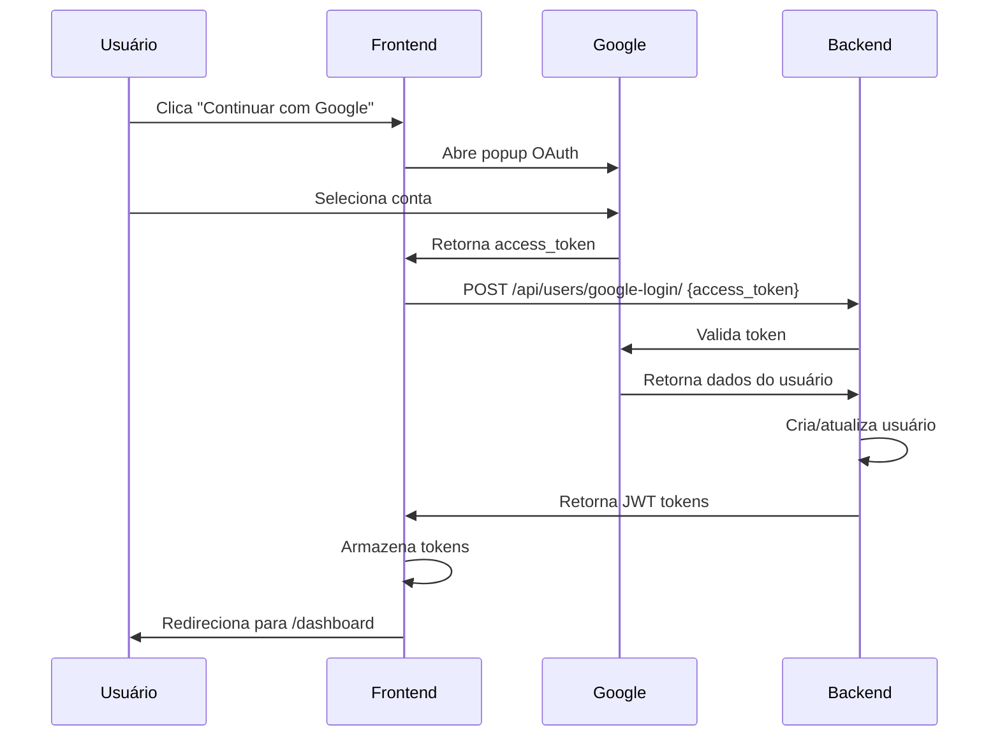

# 🔐 Configuração do Google OAuth 2.0

## 📋 Visão Geral

Este guia explica como configurar a autenticação com Google no AcadLink usando OAuth 2.0.

## ✅ O que foi implementado

### Frontend
- ✅ `@react-oauth/google` v0.13.5 instalado
- ✅ `GoogleOAuthProvider` configurado no App.jsx
- ✅ Hook customizado `useGoogleLogin` criado
- ✅ Botão "Continuar com Google" funcional em Login e Register
- ✅ Loading states e tratamento de erros
- ✅ Logo oficial do Google

### Backend (A IMPLEMENTAR)
- ⏳ Endpoint `/api/users/google-login/` (necessário)
- ⏳ Validação do access_token do Google
- ⏳ Criação ou atualização de usuário
- ⏳ Retorno de JWT tokens

---

## 🚀 Passo 1: Obter Google Client ID

### 1.1 Acesse o Google Cloud Console
Vá para: https://console.cloud.google.com/

### 1.2 Criar ou Selecionar Projeto
1. Clique em "Select a project" no topo
2. Clique em "New Project"
3. Nome do projeto: `AcadLink` (ou nome de sua escolha)
4. Clique em "Create"

### 1.3 Ativar Google+ API
1. No menu lateral, vá para "APIs & Services" > "Library"
2. Busque por "Google+ API"
3. Clique em "Enable"

### 1.4 Configurar OAuth Consent Screen
1. Vá para "APIs & Services" > "OAuth consent screen"
2. Escolha "External" (para desenvolvimento)
3. Clique em "Create"
4. Preencha:
   - **App name:** AcadLink
   - **User support email:** seu_email@gmail.com
   - **Developer contact email:** seu_email@gmail.com
5. Clique em "Save and Continue"
6. Em "Scopes", adicione:
   - `.../auth/userinfo.email`
   - `.../auth/userinfo.profile`
7. Clique em "Save and Continue"
8. Em "Test users", adicione seu email para testes
9. Clique em "Save and Continue"

### 1.5 Criar Credenciais OAuth 2.0
1. Vá para "APIs & Services" > "Credentials"
2. Clique em "Create Credentials" > "OAuth client ID"
3. Application type: **Web application**
4. Name: `AcadLink Web Client`
5. **Authorized JavaScript origins:**
   ```
   http://localhost:3000
   http://localhost:5173
   ```
6. **Authorized redirect URIs:**
   ```
   http://localhost:3000
   ```
7. Clique em "Create"
8. **COPIE o Client ID** (formato: `xxxxx.apps.googleusercontent.com`)

---

## 🔧 Passo 2: Configurar Frontend

### 2.1 Adicionar Client ID ao .env
```bash
cd frontend
```

Edite o arquivo `.env`:
```env
VITE_GOOGLE_CLIENT_ID=SEU_CLIENT_ID_AQUI.apps.googleusercontent.com
```

### 2.2 Verificar Configuração
Arquivos já configurados:
- ✅ `frontend/src/App.jsx` - GoogleOAuthProvider
- ✅ `frontend/src/hooks/useGoogleLogin.js` - Hook personalizado
- ✅ `frontend/src/pages/auth/Login.jsx` - Botão Google
- ✅ `frontend/src/pages/auth/Register.jsx` - Botão Google

### 2.3 Testar Frontend
```bash
npm run dev
```

1. Abra http://localhost:3000/login
2. Clique em "Continuar com Google"
3. Popup do Google deve abrir
4. Selecione sua conta
5. Você verá erro 404 no backend (normal - backend não implementado ainda)

---

## 🐍 Passo 3: Implementar Backend (Django)

### 3.1 Instalar Dependências
```bash
cd backend
pip install google-auth google-auth-oauthlib google-auth-httplib2
pip install social-auth-app-django  # Opcional: biblioteca completa
```

### 3.2 Criar View de Google Login

**Arquivo:** `backend/apps/users/views.py`

Adicione:
```python
from rest_framework.decorators import api_view, permission_classes
from rest_framework.permissions import AllowAny
from rest_framework.response import Response
from rest_framework import status
from google.oauth2 import id_token
from google.auth.transport import requests
from django.conf import settings
from rest_framework_simplejwt.tokens import RefreshToken

@api_view(['POST'])
@permission_classes([AllowAny])
def google_login(request):
    """
    Autentica usuário via Google OAuth
    
    Recebe: { "access_token": "google_access_token" }
    Retorna: { "access_token": "jwt", "refresh_token": "jwt" }
    """
    try:
        token = request.data.get('access_token')
        if not token:
            return Response(
                {'detail': 'access_token é obrigatório'}, 
                status=status.HTTP_400_BAD_REQUEST
            )
        
        # Validar token com Google
        # Buscar informações do usuário do Google
        import requests as http_requests
        response = http_requests.get(
            'https://www.googleapis.com/oauth2/v3/userinfo',
            headers={'Authorization': f'Bearer {token}'}
        )
        
        if response.status_code != 200:
            return Response(
                {'detail': 'Token inválido'}, 
                status=status.HTTP_401_UNAUTHORIZED
            )
        
        google_user = response.json()
        email = google_user.get('email')
        
        if not email:
            return Response(
                {'detail': 'Email não encontrado'}, 
                status=status.HTTP_400_BAD_REQUEST
            )
        
        # Buscar ou criar usuário
        user, created = User.objects.get_or_create(
            email=email,
            defaults={
                'username': email.split('@')[0],
                'first_name': google_user.get('given_name', ''),
                'last_name': google_user.get('family_name', ''),
                'is_email_verified': True,
            }
        )
        
        # Gerar JWT tokens
        refresh = RefreshToken.for_user(user)
        
        return Response({
            'access_token': str(refresh.access_token),
            'refresh_token': str(refresh),
            'user': {
                'id': user.id,
                'email': user.email,
                'username': user.username,
                'first_name': user.first_name,
                'last_name': user.last_name,
            }
        }, status=status.HTTP_200_OK)
        
    except Exception as e:
        return Response(
            {'detail': str(e)}, 
            status=status.HTTP_500_INTERNAL_SERVER_ERROR
        )
```

### 3.3 Adicionar Rota

**Arquivo:** `backend/apps/users/urls.py`

Adicione:
```python
from .views import google_login

urlpatterns = [
    # ... rotas existentes
    path('google-login/', google_login, name='google-login'),
]
```

### 3.4 Adicionar ao requirements.txt

**Arquivo:** `backend/requirements/base.txt`

Adicione:
```txt
google-auth==2.23.0
google-auth-oauthlib==1.1.0
google-auth-httplib2==0.1.1
```

### 3.5 Instalar e Testar Backend
```bash
pip install -r requirements/base.txt
python manage.py runserver
```

---

## 🧪 Passo 4: Testar Integração Completa

### 4.1 Checklist de Teste

#### Frontend
- [ ] npm run dev rodando
- [ ] VITE_GOOGLE_CLIENT_ID configurado
- [ ] Botão "Continuar com Google" aparece
- [ ] Clicar abre popup do Google
- [ ] Popup não mostra erros

#### Backend
- [ ] python manage.py runserver rodando
- [ ] Endpoint `/api/users/google-login/` existe
- [ ] Dependências do Google instaladas
- [ ] Migrations aplicadas

#### Fluxo Completo
1. [ ] Acesse http://localhost:3000/login
2. [ ] Clique em "Continuar com Google"
3. [ ] Selecione conta do Google no popup
4. [ ] Popup fecha automaticamente
5. [ ] Frontend redireciona para /dashboard
6. [ ] Token JWT armazenado no localStorage
7. [ ] Usuário logado com sucesso

### 4.2 Testar com cURL

```bash
# 1. Obter access_token do Google (use o console do navegador após login)
# 2. Testar endpoint:
curl -X POST http://localhost:8000/api/users/google-login/ \
  -H "Content-Type: application/json" \
  -d '{"access_token":"TOKEN_DO_GOOGLE_AQUI"}'
```

Resposta esperada:
```json
{
  "access_token": "eyJ0eXAiOiJKV1QiLCJhbGc...",
  "refresh_token": "eyJ0eXAiOiJKV1QiLCJhbGc...",
  "user": {
    "id": 1,
    "email": "usuario@gmail.com",
    "username": "usuario",
    "first_name": "Nome",
    "last_name": "Sobrenome"
  }
}
```

---

## 🔒 Passo 5: Segurança

### 5.1 Validações Obrigatórias

#### Backend
- ✅ Verificar token com Google API
- ✅ Validar email do usuário
- ✅ Rate limiting no endpoint
- ✅ HTTPS em produção
- ✅ Client ID válido

#### Frontend
- ✅ HTTPS em produção
- ✅ Client ID em variável de ambiente
- ✅ Não expor tokens no console
- ✅ Limpar tokens em logout

### 5.2 Produção

#### Frontend
Adicione ao `.env.production`:
```env
VITE_GOOGLE_CLIENT_ID=SEU_CLIENT_ID_PRODUCAO
VITE_API_URL=https://api.acadlink.com/api
```

#### Backend
Adicione ao `.env`:
```env
GOOGLE_CLIENT_ID=SEU_CLIENT_ID_PRODUCAO
GOOGLE_CLIENT_SECRET=SEU_CLIENT_SECRET
```

#### Google Cloud Console
Adicione URLs de produção:
```
https://acadlink.com
https://www.acadlink.com
```

---

## 🐛 Troubleshooting

### Erro: "idpiframe_initialization_failed"
**Causa:** Client ID inválido ou não configurado
**Solução:** Verifique VITE_GOOGLE_CLIENT_ID no .env

### Erro: "redirect_uri_mismatch"
**Causa:** URL não autorizada no Google Console
**Solução:** Adicione URL em "Authorized redirect URIs"

### Erro: "popup_closed_by_user"
**Causa:** Usuário fechou popup antes de concluir
**Solução:** Normal - não é erro

### Erro: 404 no endpoint google-login
**Causa:** Backend não implementado
**Solução:** Implemente a view conforme Passo 3

### Token JWT não armazenado
**Causa:** Backend não retorna access_token
**Solução:** Verifique response do backend

### Usuário não redireciona para dashboard
**Causa:** Erro no callback onSuccess
**Solução:** Verifique console do navegador

---

## 📊 Fluxo Completo



---

## 📁 Estrutura de Arquivos

```
frontend/
├── .env                                    # ✅ Client ID aqui
├── src/
│   ├── App.jsx                             # ✅ GoogleOAuthProvider
│   ├── hooks/
│   │   └── useGoogleLogin.js               # ✅ Hook customizado
│   ├── pages/auth/
│   │   ├── Login.jsx                       # ✅ Botão Google
│   │   └── Register.jsx                    # ✅ Botão Google
│   └── components/ui/
│       └── GoogleIcon.jsx                  # ✅ Logo oficial

backend/
├── apps/users/
│   ├── views.py                            # ⏳ google_login view
│   └── urls.py                             # ⏳ rota /google-login/
└── requirements/
    └── base.txt                            # ⏳ google-auth
```

---

## ✅ Checklist Final

### Configuração Inicial
- [ ] Google Cloud Console - Projeto criado
- [ ] OAuth Consent Screen configurado
- [ ] OAuth 2.0 Client ID criado
- [ ] Client ID copiado

### Frontend
- [ ] VITE_GOOGLE_CLIENT_ID no .env
- [ ] npm install executado
- [ ] App.jsx com GoogleOAuthProvider
- [ ] Botões Google funcionando

### Backend
- [ ] Dependências do Google instaladas
- [ ] View google_login implementada
- [ ] Rota /google-login/ adicionada
- [ ] Migrations aplicadas

### Testes
- [ ] Login com Google funciona
- [ ] Registro com Google funciona
- [ ] Tokens JWT armazenados
- [ ] Redirecionamento correto
- [ ] Erros tratados corretamente

---

## 🎓 Próximos Passos

1. **Implementar backend** conforme Passo 3
2. **Testar fluxo completo** conforme Passo 4
3. **Adicionar Microsoft OAuth** (similar ao Google)
4. **Adicionar GitHub OAuth** (similar ao Google)
5. **Melhorar tratamento de erros**
6. **Adicionar analytics de conversão**

---

**Data:** 18 de Agosto de 2026  
**Status:** Frontend completo ✅ | Backend pendente ⏳
